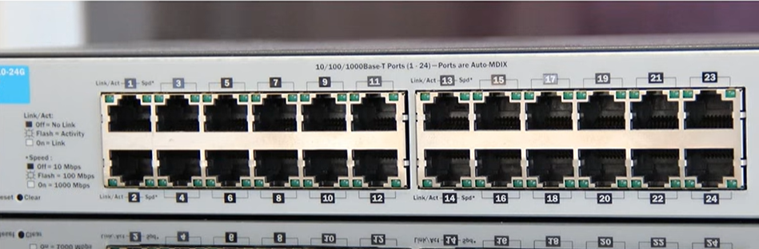
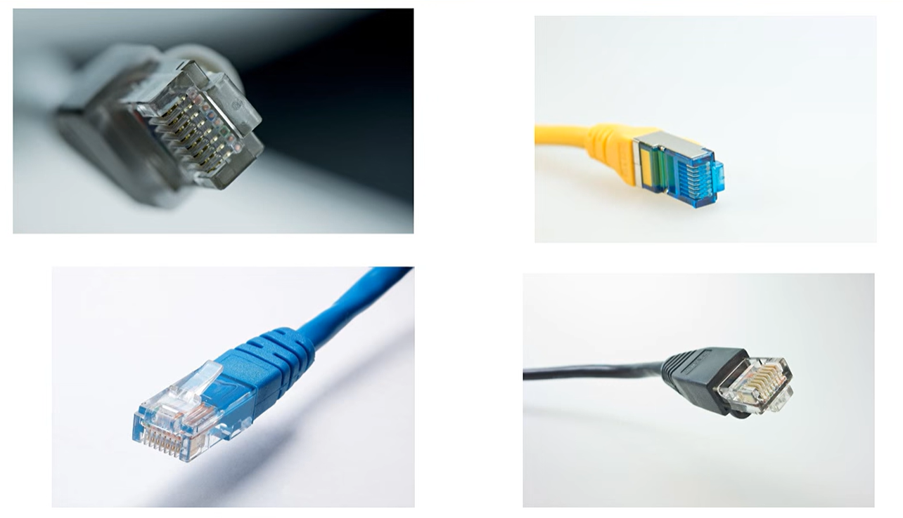
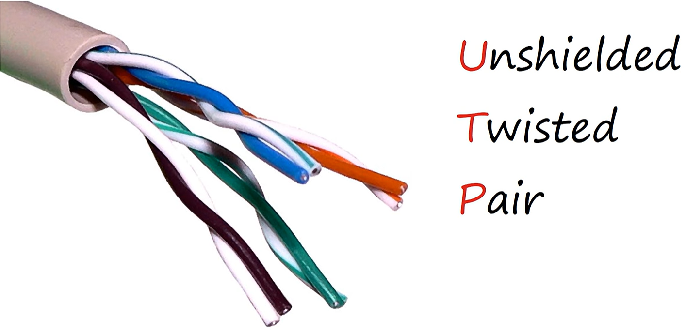
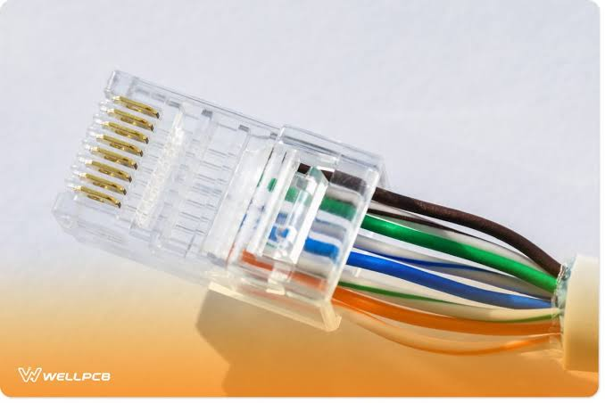
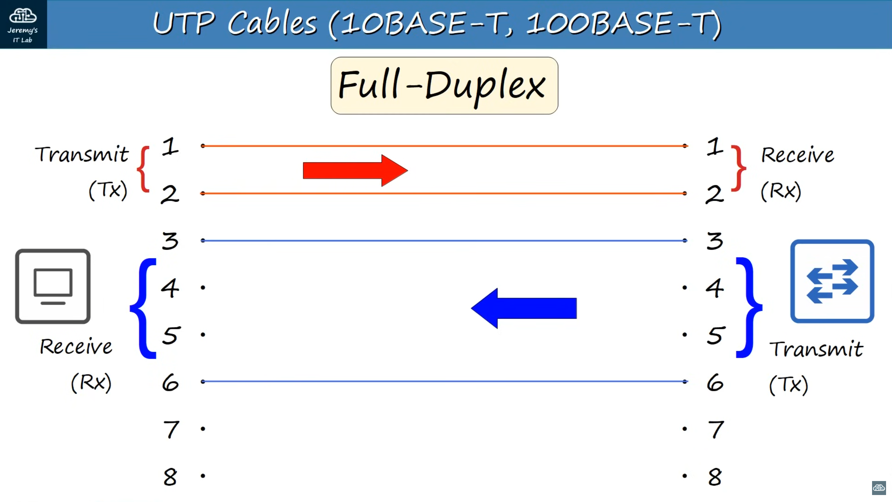
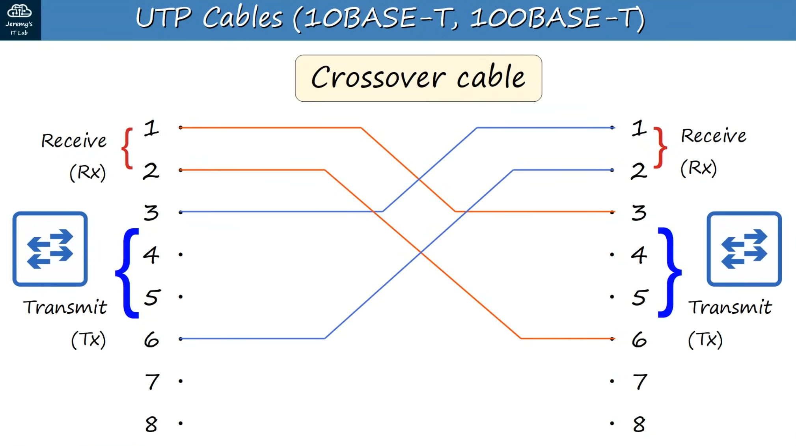

# Interfaces and Cables

## Table of Contents
- [Ethernet](#ethernet)
- [Bits and Bytes](#bits-and-bytes)
- [Copper UTP Cables](#copper-utp-cables)
- [Fiber-Optic Cables](#fiber-optic-cables)

## Ethernet
- a collection of standards and protocols defined in **IEEE 802.3** (document by IEEE)
- this lesson focuses on the types of cabling defines by Ethernet

## Bits and Bytes
Connections between devices operate at a set speed, measured in **bits per second (bps)**

| Size | # of Bits |
| --- | --- |
| 1 kilobit (Kb) |  1,000 |
| 1 megabit (Mb) | 1,000,000 |
| 1 gigabit (Gb) | 1,000,000,000 |
| 1 terabit (Tb) | 1,000,000,000,000  |

## Copper UTP Cables

In the image directly above, the cable is a copper UTP cable and the plastic thingy is called a RJ-45 connector. They are put onto both ends of a UTP cable and it allows them to connect to the RJ-45 ports on a switch.

"unshielded", no metallic shield, which makes them vulnerable to electrical interference\
"twisted pair", since pairs of wires are twisted together which prevents electromagnetic interference (EMI)

An RJ-45 connector has 8 pins (the golden metal part). There are divisions inside the connector that allow you to slide in an individual wire so that it touches one pin. This means RJ-45 connectors allow 4 pairs, or 8 wires. Most have 4 pairs but there are old ones that only have 2 pairs.
- 10/100BASE-T use 2 pairs
- 1000/10G-BASE-T use 4 pairs

### Copper UTP Cable Standards
These standards define UTP copper cables.
| Speed | Common Name | Standard | Cable Type | Max Transmission Distance |
| --- | --- | --- | --- | --- |
| 10 Mbps | Ethernet | 802.3i | 10BASE-T | 100m Max |
| 100 Mbps | Fast Ethernet | 802.3u | 100BASE-T | 100m Max |
| 1 Gbps | Gigabit Ethernet | 802.3ab | 1000BASE-T | 100m Max |
| 10 Gbps | 10 Gigabit Ethernet | 802.3an | 10GBASE-T | 100m Max |

Common name is what people actually call the cable, people wouldn’t want to say “802.3i cable”.\
BASE = refers to baseband signaling, you don’t need to know what means, T = twisted pairs

### 10BASE-T and 100BASE-T

The image above is a straight through cable example. Both straight through and crossover support full duplex communication

| DEVICE TYPE | TRANSMIT (TX) PINS | RECEIVE (RX) PINS |
| --- | --- | --- |
| ROUTER | 1 and 2 | 3 and 6 |
| FIREWALL | 1 and 2 | 3 and 6 |
| PC | 1 and 2 | 3 and 6 |
| SWITCH | 3 and 6 | 1 and 2 |

**Full duplex** is when devices can receive and transmit at the same time. 

A **straight through** cable is used when the transmitting pin numbers of the transmitting device correspond to the receiving pin numbers of the receiving device. 

A **crossover** cable is used when the transmitting pin numbers of the transmitting device don’t correspond to the receiving pin numbers and instead of the transmitting pin numbers of the receiving device. (ex. need to connect PC to router, or same device to each other)

Most modern equipment now has **AUTO MDI-X** feature which automatically detects which pins their neighbour is transmitting on and adjusts the pins they receive data on, therefore if this feature is enabled it doesn’t matter if you use straight through or crossover.

### 1000BASE-T and 10GBASE-T
Each wire pair is bidirectional, meaning a pair isn’t exclusively for transmitting or receiving. 
This allows them to transmit and receive at faster speeds. 

## Fiber-Optic Cables

