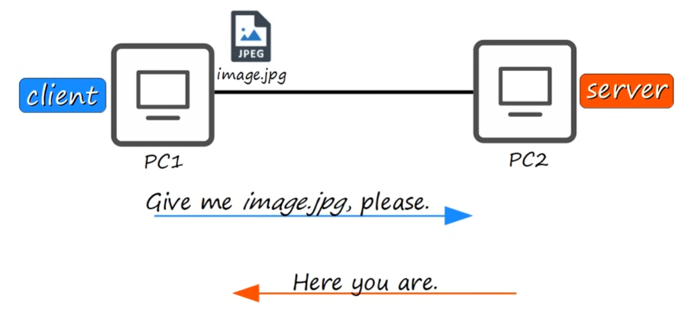
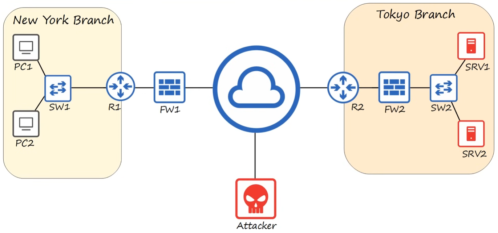

# Network Devices
## Table of Contents
- [Network](https://github.com/ashorishicx/CCNA-Notes/blob/main/network-devices/README.md#network)
- [End Point Devices / Hosts](https://github.com/ashorishicx/CCNA-Notes/blob/main/network-devices/README.md#end-point-devices--hosts)
- [Intermediary Devices](https://github.com/ashorishicx/CCNA-Notes/blob/main/network-devices/README.md#intermediary-devices)

## Network

A **computer network** is a collection of interconnected devices that share resources with each other.

## End Point Devices / Hosts

- **Client**: a device that requests a resource from another device, called the server.
- **Server**: A device that provides resources to another device, called a client.
- An endpoint / host can be a client in some situations or a server in others

## Intermediary Devices
- intermediary devices facilitate communication between two endpoints / hosts
### Switch
- Without a switch, a device in the network would need an individual connection to each device in their LAN to be able to send a message to anyone in their LAN.
- A switch eliminates this by having everyone in the LAN connect to it. When a switch receives a message from a connected device, it sends the message out the port that the intended recipient of the message within the network has connected to on the switch. 
- Has lots of ports, this is so that every device in the LAN can connect to it
### Router
- have fewer network interfaces/ports than switches
- are used to provide connectivity **between** LANs (switches could only provide connectivity **within** LANs)
### Firewall
- monitor and control network traffic based on configured rules
- can be placed **outside** of your LAN (filter traffic *before* reaching the router)
- can be placed **inside** of your LAN (filter traffic *after* going through the router)
- are considered **Next Generation Firewalls (NGFW)** when they include more modern and advanced filtering capabilities

