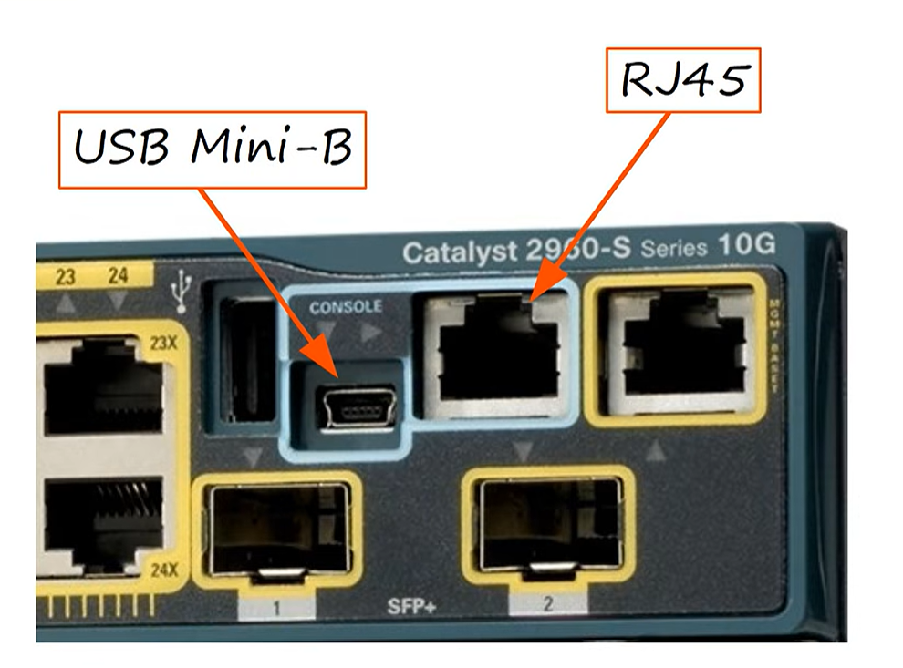
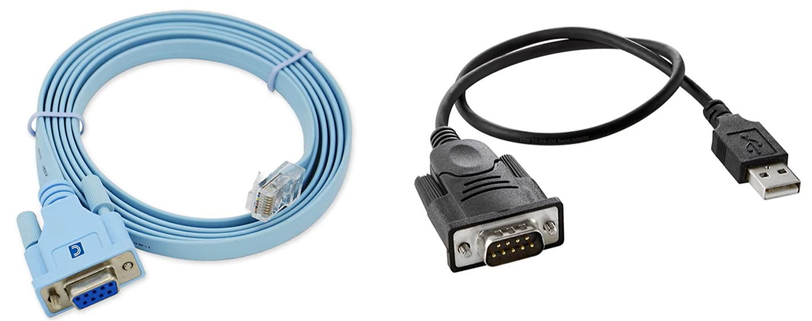
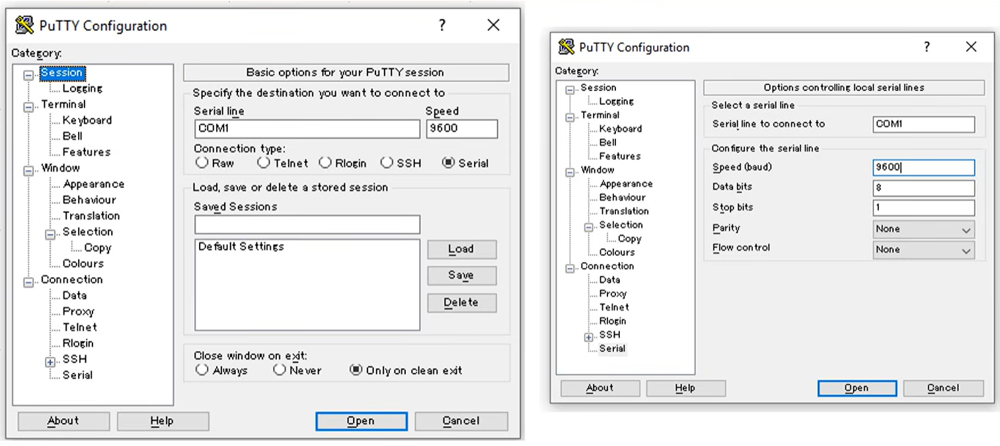

# Intro to the CLI
"Cisco IOS" is the operating system used on cisco devices (like Windows on a PC, or MacOS on a iMac) that allows you to make configurations to the cisco device. Making configurations means making changes to the settings of the device, such as enabling or disabling the AUTO-MDIX feature of a switch. The Cisco IOS is a command line interface (CLI), meaning you enter commands.

## Table of Contents
- [How do you access the CLI?](#how-do-you-access-the-cli)
- [Modes of the CLI](#modes-of-the-cli)

## How do you access the CLI?
There are several methods to access a cisco device's CLI:
- via Console
- remotely via SSH or Telnet (we will cover these methods in later lessons)

### Console Connection
- you will need a laptop to type the commands on the CLI
- you will need a **rollover cable** that connects the laptop to the cisco device's console port
- after plugging in, you need a **terminal emulator** app on your laptop (ex. PuTTy is a popular choice) and select connect via "Serial"

\
The blue cable is the rollover cable. Most laptops today don't have a serial port, so in order to get the other end of the rollover cable to connect to the laptop, you will need that black cable. It will connect to the serial connector of the rollover cable and the other end has a USB connector which can be plugged into the laptop. 

On the right is an image changes you can make to your console connection. You rarely will need to make changes to these and you do not need to know what it means, but you should memorize the default settings.

## Modes of the CLI
There are various modes that you can be in. The mode you're currently in will can allow or restrict you from entering certain commands. You can enter or leave modes by typing certain commands.\
\
There is also a series of letters before the area where you can type, like `Router>`: "Router" is the hostname of the device and the symbols following that, like ">", will represent the mode you're currently in.\

### User EXEC Mode
When you first open the CLI, you will be in **User EXEC mode**.\
`Router>` the `>`represents that you're currently in User EXEC mode.\
This mode allows you to view the device's configurations, but not change configurations.

### Privileged EXEC Mode
If you enter the command `enable` in user EXEC mode, you can enter **Privileged EXEC Mode**\
\
`Router> enable`\
`Router#`  The `#` represents that you're currently in Privileged EXEC mode.\
\
This mode gives you more access to the device's configuration, restart the device, etc.
You cannot change configurations, but can change time on the device, save configuration file, etc.

### Global Configuration Mode
If you enter the command `configure terminal`, you will enter **Global Configuration Mode**\
\
`Router# configure terminal` (also conf t is the shortest possible abbreviation)\
`Router(config)#`  The `(config)#` represents that you're currently global configuration mode.\
\
This mode allows you to enter commands that make changes to the whole device.\
This mode will allow you to enter other modes that allow you to make changes to specific areas on the device. We will learn about them later. 

## CLI Shortcuts
### The Question Mark Command
You can use the `?` command in any mode to view available commands on that mode.\
\
You can also do something like this: \
`Router>e?`\
and it would should you all the possible commands that begin with the letter e. 

### The Tab Key
If you type this:\
`Router> en`\
And if you press tab, it will spell out the full command:\
`Router> enable`

### Command Abbreviations
Also, you don't really need to type the full command, pressing enter even if you just typed this:\
`Router> en`\
will execute. However keep in mind there are limits to abbreviating commands. Just doing this:\
`Router> en`\
will result in the CLI telling you "% Ambiguous command: "e"". Best way to figure out is just by experimenting. 

## Commands
There are obviously a lot more commands but these are the ones will learn this module:

### enable password
In global configuration mode:\
`Router(config)#enable password CCNA`\
will set a password, in this example CCNA, as the password in order to enter privileged exec mode.\
passwords are case sensitivie

### exit
You can enter this command in any mode you're in, and you will go back to a lower privileged mode, for example:\
`Router#exit`\
will make you return you to user EXEC mode.\
`Router>`

### running-config

### startup-config

