# How the TCP/IP Model Actually Works
This lesson will give you a big picture on how networks work. We'll go over it more on detail, such as how each protocol specifically works, in more detail throughout the course.

## Table of Contents
- [The Importance of Protocols and Standards](#the-importance-of-protocols-and-standards)
- [What is a network model?](#what-is-a-network-model)
- [TCP/IP Model](#tcpip-model)
- [Layer Interaction Concepts](#layer-interaction-concepts)
- [OSI Model](#osi-model)

## The Importance of Protocols and Standards
- A **protocol** is a set of rules defining how data should be communicated between devices over a network
  - For humans, we have specific social rules for different aspects of communication. For networks, those rules are protocols.
- A **standard** is an agreed-upon way for how a protocol or technology should work
  - A group of people could define a protocol to understand each other, but it if you apply that protocol to a different group, they will not understand you as it has not been agreed-upon and they have a defined how to communicate differently.
  - In the past, vendors or computers would create their own proprietary protocols, which meant only devices of the same vendor could understand each other. Standard organizations have made standards for protocols and technologies to combat this.
  - Standard Organizations are independent organizations that create standards containing people from various companies
    - IEEE = Institute of Electrical and Electronic Engineers
      - developed many of the technologies used in LANs: Ethernet (IEEE 802.3) and WiFI (802.11)
    - IETF = Internet Engineering Task Force
      - open community that defines protocols used in the internet: TCP, IP, UDP, HTTP, DNS
      - publishes standards in documents called RFCs = Request for Comments

## What is a network model?
- networks need to do various jobs when transporting data from the sender to the recipient
  - transmitting physical signals on a medium (need to get data from one device to another)
  - local delivery on the LAN (need to figure out the next device nearby that can help send the data to its recipient)
  - have applications on the endpoints have conversations (you don't just focus on sending a singular message, conversations contain multiple messages between people!)
  - did the sender format the data they're sending correctly for the application (just like how you need to word your sentences right)
- network models are a way of grouping protocols into layers based on the job they do, why the word "layers"?:
  - each layer has a specific role, and protocols are categorized into that layer if they fit the role of the layer
  - each layer needs the jobs done by the layers below
  - each layer’s jobs allows the layer above to do their jobs
- a protocol is the protocols from layers of the model that work together for a successful communication

## An Analogy to Understand the TCP/IP Network Model
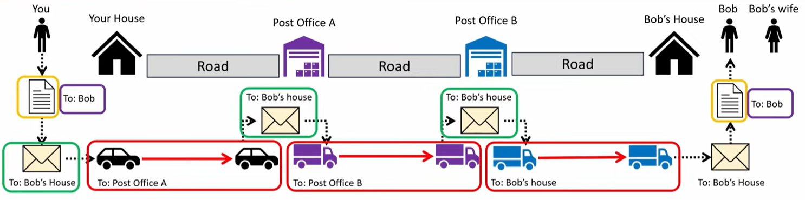
1. You write a letter addressed to **Bob**
2. You put in an envelope addressed to **Bob's house**
3. You bring the envelope into your car to bring it to **Post Office A**, as Bob's house is quite far from you
4. Post Office A will bring the envelope to a truck to bring it to **Post Office B** as it is the closest post office nearby that may be able to find another post office that can bring it closer to Bob's house OR it is a post office that is near enough to deliver it themselves
5. Post Office B will bring the envelope to a truck and brings it to **Bob's house** because it provides service to Bob's area
6. Bob opens their mailbox and reads it because they're the resident in their house that the envelope belongs to

On the left is what a mail model would be. On the right is what it is similarly on the TCP/IP model.
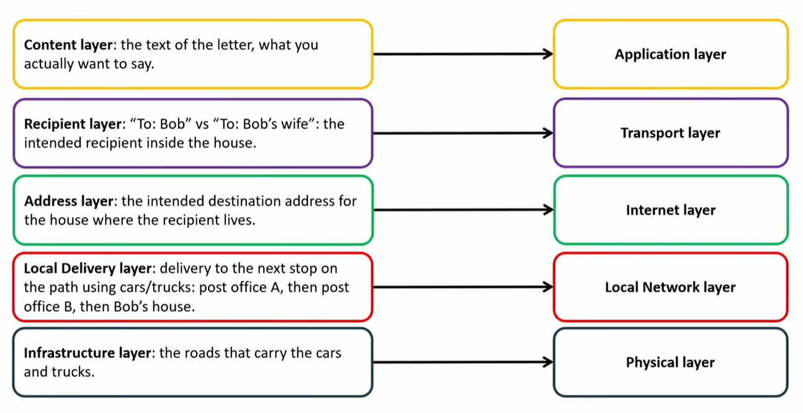

## TCP/IP Model
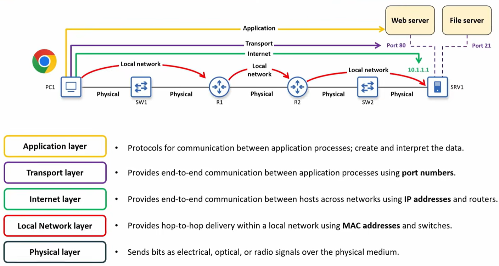
Port numbers identify the application the message on the computer belongs to, like who the envelope belongs to in a house\
IP addresses identify the network a host is in and where it is within that network, like the address of a house\
MAC addresses is a different type of address which identifies the next device to send it to, like stops before delivering an envelope\
Cables transmit messages between two devices, like the roads between the houses and post offices

### Physical Layer (L1)
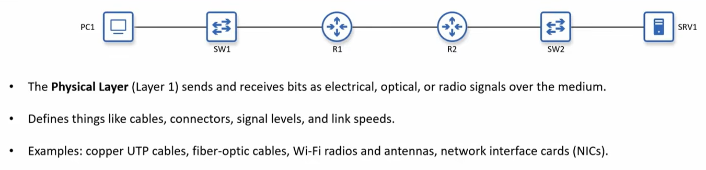
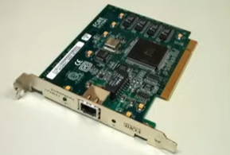\
This is a network interface card (NIC). It contains the port and also has the MAC address burned into it, hence why it is called a burned in address (BIA). MAC addresses are associated with the next layer though. 

### Local Network Layer (L2)
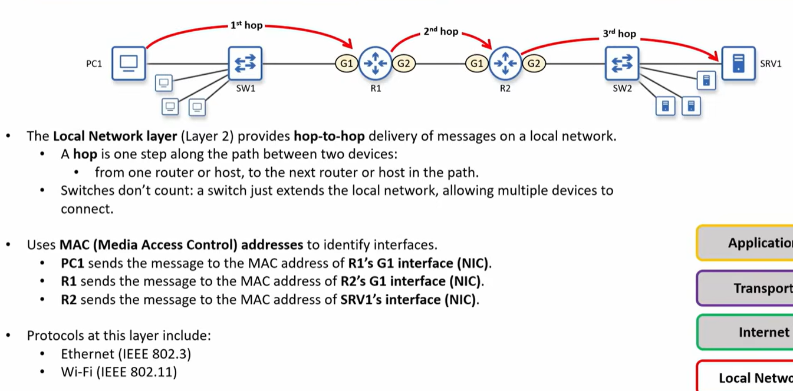
Also you do not address a message to the MAC address of a switch in order for it to reach the switch. This confusion is common among those who don’t understand the purpose of a switch. Reread the definition from [Network Devices](./network-devices). It just reads the MAC address of the message and it will know what port to send it out of (this process is called switching). 

### Internet Layer (L3)
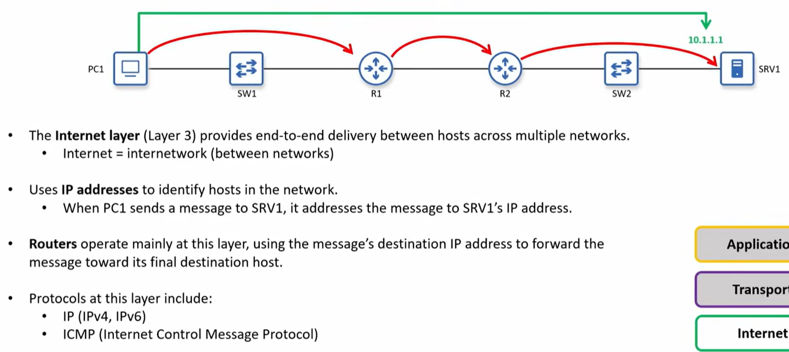

### Transport Layer (L4)
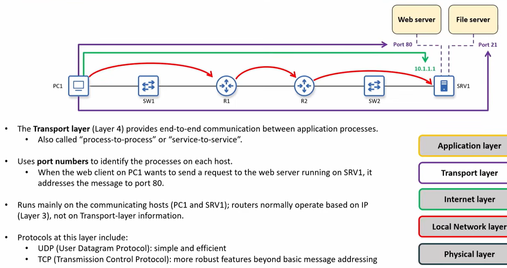

### Application Layer (L5, also called L7, more on that later)
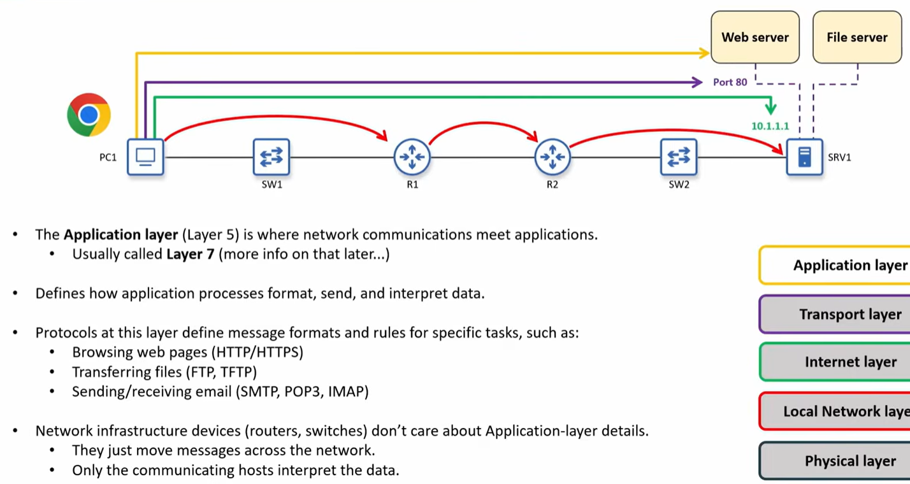

## Encapsulation and Decapsulation
In order for the letter in the main analogy to be properly delivered, it was encapsulated into many things: an envelope, which was then encapsulated inside a car, and then de-encapsulated and re-encapsulated into a truck. These steps were necessary as every layer of encapsulation the letter received helped bring the letter one step closer to the recipient.\
\
In networking, data is encapsulated with other data to help other devices know where to send it and is also de-encapsulated and re-encapsulated by routers (think of them as the post offices in the mail analogy) to help bring it closer to its recipient. Also, think of the fact that data is given metadata as an implementation of network protocols. Just like with mail, there are rules for how to properly send a letter.

### Encapsulation
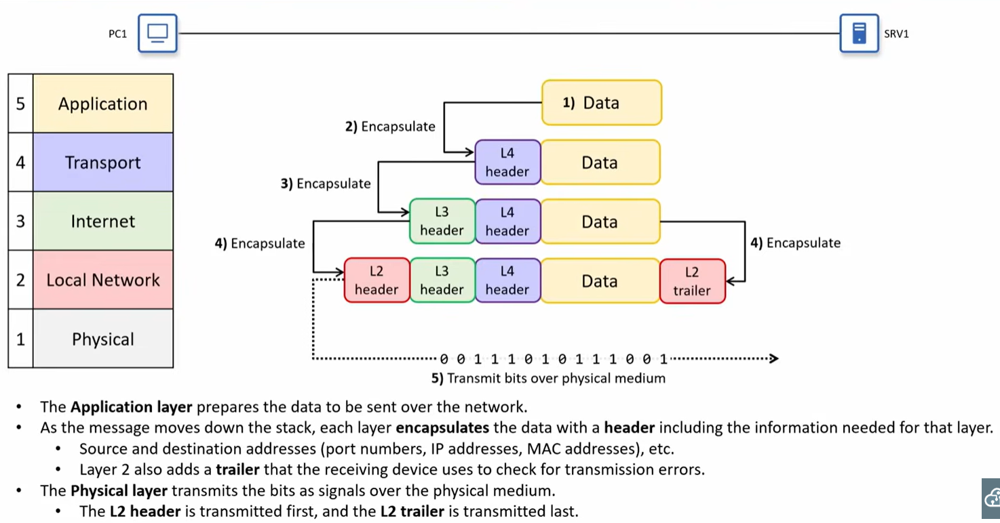

### Decapsulation
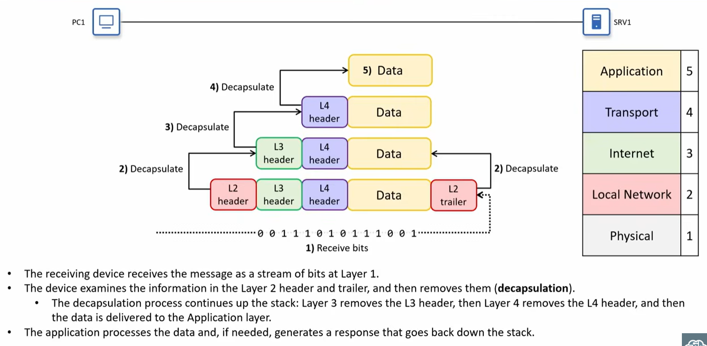

### Protocol Data Units
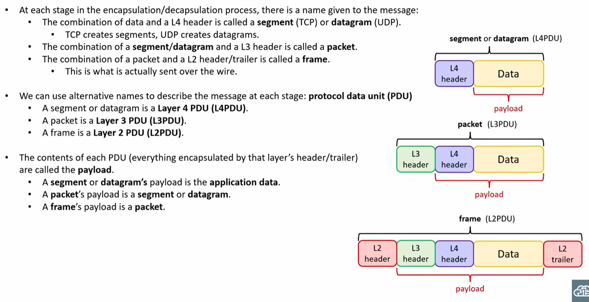

## Layer Interaction Concepts
### Adjacent-layer interaction
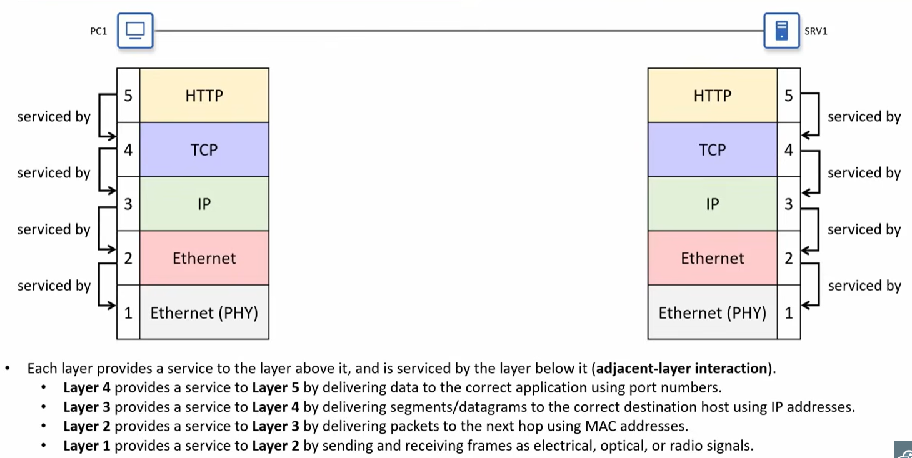

### Same-layer interaction
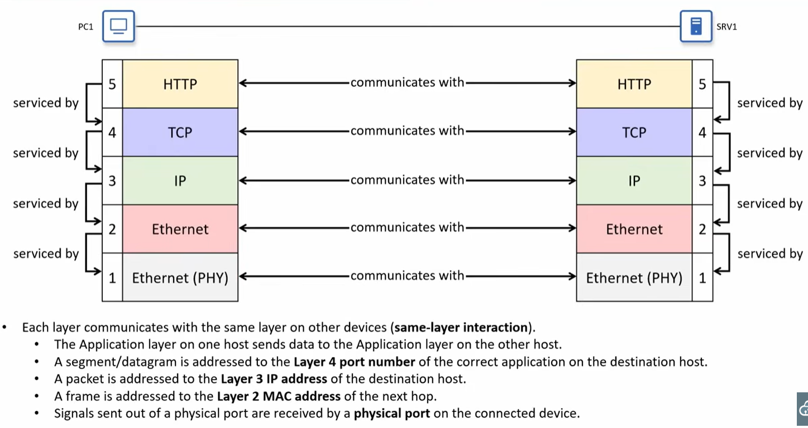

### Separation of layers
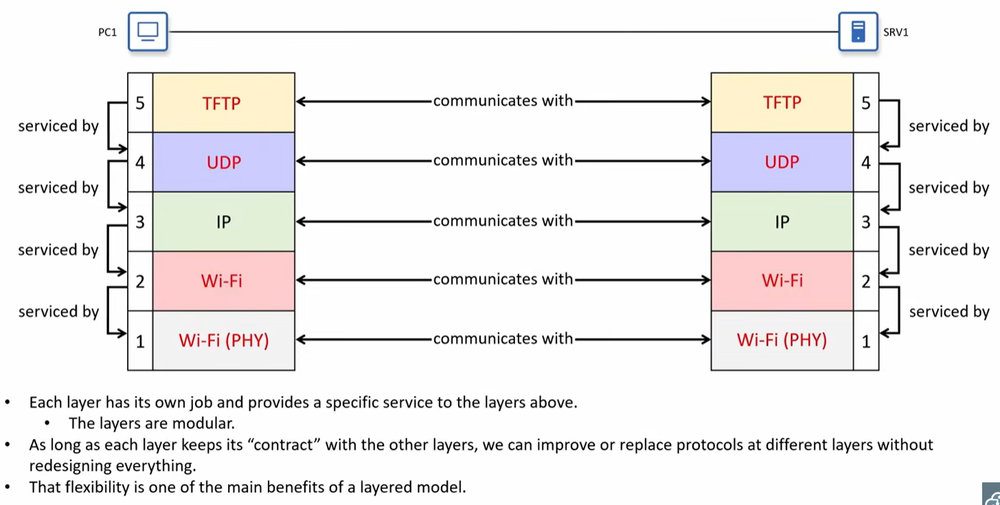

## OSI Model
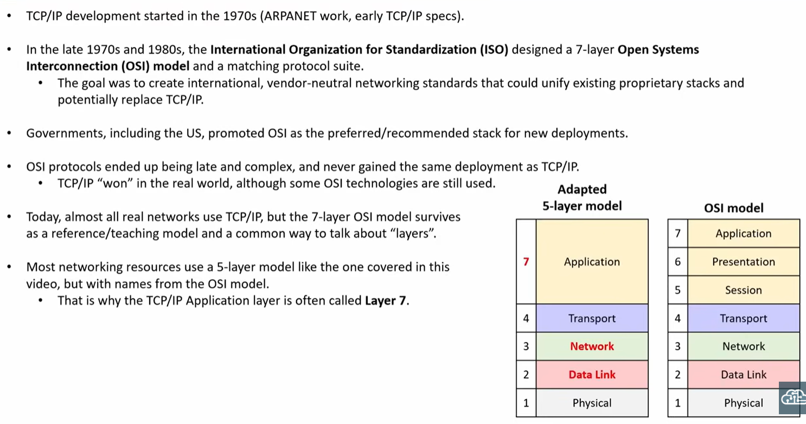

